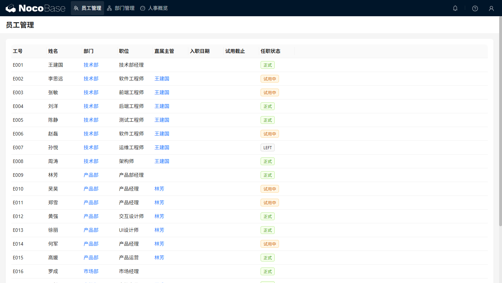
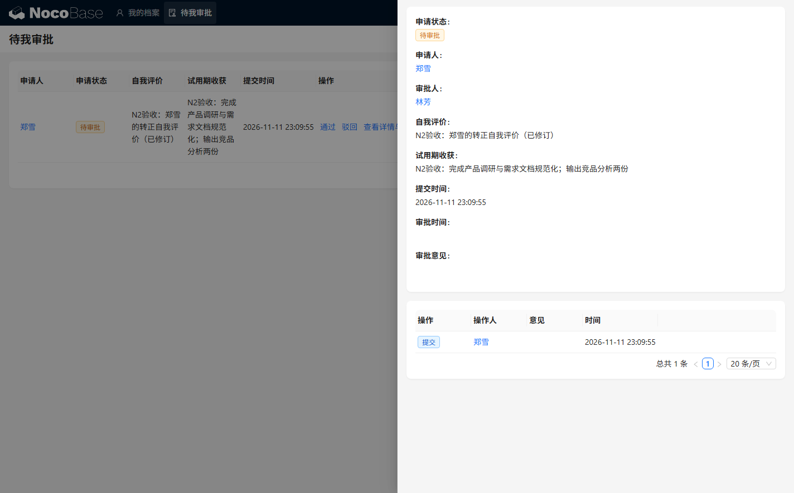
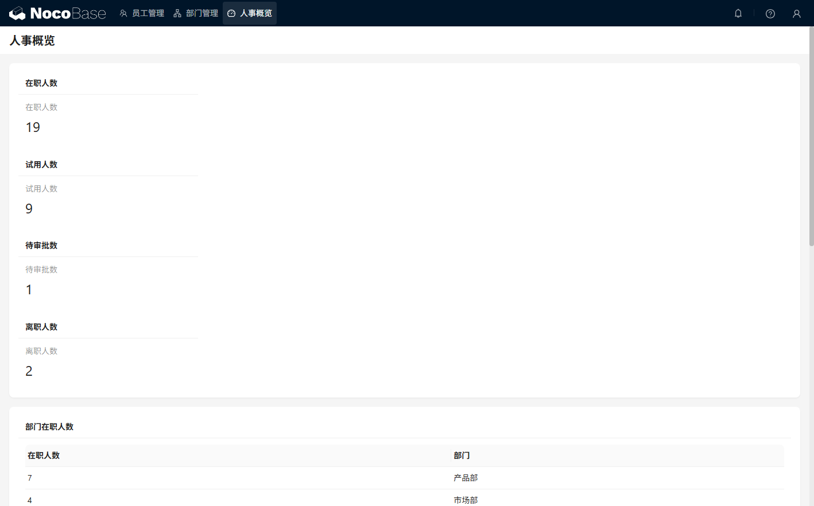
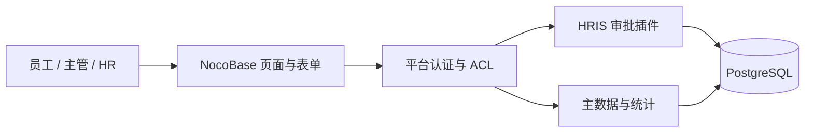

# HRIS 员工与转正管理系统

基于 **NocoBase + PostgreSQL** 的人事管理系统，覆盖部门与员工档案、转正申请、主管审批、审批轨迹和人事统计。业务页面、表单与数据权限通过低代码配置实现，审批规则通过 JavaScript 插件扩展。

## 核心功能

| 模块 | 功能 |
|---|---|
| 组织与员工 | 部门维护、员工档案、直属主管与账号绑定、按部门和状态筛选 |
| 转正申请 | 保存与编辑草稿、提交申请、查看审批意见、驳回后重新申请 |
| 主管审批 | 查看本人待办、通过或驳回、必填驳回意见、查询审批轨迹 |
| 数据权限 | 员工查看本人、主管查看本人及直属下属、HR 维护全量主数据 |
| 人事概览 | 在职、试用、待审批、离职统计，以及部门在职人数 |
| 低代码扩展 | 新增字段进入业务表单与档案列表，兼容已有记录 |
| 运行维护 | 幂等初始化、隔离验证、共享快照备份与恢复校验 |

申请流转：**草稿 → 提交 → 主管审批 → 通过 / 驳回**。通过后员工状态变为正式；驳回后可重新申请，原记录与轨迹保留。

## 界面预览

员工档案管理：



审批详情与操作轨迹：



人事概览：



截图来自已执行的浏览器验证，使用虚构数据；统计值随业务操作变化。

## 技术架构



- **低代码平台**：NocoBase `2.2.37-full`，提供登录、集合、页面设计器、ACL 和图表。
- **业务扩展**：JavaScript 插件实现 `saveDraft / submit / approve / reject`，服务端校验角色、申请人、审批人和状态。
- **数据一致性**：事务与行锁防止重复决定；账号唯一绑定和关系守卫约束覆盖数据库写入。
- **部署**：Docker Compose，PostgreSQL `16.3` 镜像按 digest 锁定；应用默认仅监听本机。
- **工程脚本**：PowerShell、Python 与 Node.js，负责初始化、运行维护和自动化验证。

详细说明见[系统架构](docs/design/ARCHITECTURE.md)、[数据模型](config/model.md)和[权限规则](config/permissions.md)。

## 快速开始

需要 Docker Desktop / Compose v2、Python 3（安装 `requests`）和 PowerShell。浏览器自动化另需 Node.js 与 Chrome。以下命令均在仓库根目录执行。

```powershell
# 仅首次配置时复制；已有 .env 请保留
Copy-Item .env.example .env
# 编辑 .env，填写 APP_KEY、数据库密码、管理员密码和业务演示密码
python -m pip install requests

powershell -NoProfile -File .\scripts\start.ps1
# 等待应用启动完成，再初始化模型、权限、插件、页面与演示数据
powershell -NoProfile -File .\scripts\seed.ps1 -WithDemo
```

打开 [http://127.0.0.1:13000](http://127.0.0.1:13000)。管理员使用 `.env` 中的 `INIT_ROOT_EMAIL / INIT_ROOT_PASSWORD`，业务账号见[账号说明](docs/demo/DEMO-ACCOUNTS.md)。

完整启动、停止、备份和隔离复现步骤见[运行说明](docs/operations/REPRODUCE.md)。

## 验证

已有验证记录覆盖 **76 项 API 断言**：权限 9、报表 13、回归 29、业务闭环 25。账号唯一绑定专项首跑 18 项、重复执行含删字段路径 22 项；另有浏览器审批、统计和低代码字段验证。

会改变业务状态的套件要求显式指定独立 Compose 项目，并在写入前拒绝主实例。运行命令、证据和未覆盖项见[验证报告](docs/quality/VERIFICATION.md)与[验收场景](docs/quality/UAT.md)。

## 项目结构

```text
.
├── README.md                    # 项目介绍与快速开始
├── .env.example                 # 环境变量模板
├── deploy/                      # Docker Compose
├── config/                      # 数据模型、权限、页面配置说明
├── packages/plugins/            # HRIS 自定义插件
├── scripts/                     # 初始化、演示、备份与验证脚本
│   └── browser/                 # 浏览器自动化探针
├── docs/
│   ├── START-HERE.md            # 文档导航
│   ├── REPOSITORY-MAP.md        # 目录与脚本索引
│   ├── design/                 # 架构、审批实现、统计口径
│   ├── operations/             # 运行复现、版本锁定
│   ├── demo/                   # 操作流程、账号、低代码扩展
│   ├── quality/                # 验证、验收场景、已知边界
│   └── evidence/               # 实际截图与测试日志
├── AGENTS.md / CLAUDE.md        # 开发协作约定
└── BLACKBOARD.md                # 当前交付与审查状态
```

## 范围与边界

当前支持单级直属主管审批与本地单实例部署，未实现多级会签、薪酬、考勤、多租户及高可用。仅使用虚构数据；备份恢复验证限定当前平台与数据库版本。平台适配细节见[已知边界](docs/quality/LIMITATIONS.md)。

NocoBase 提供底层平台能力，本仓库包含业务配置、自定义审批插件和运行验证脚本；上游平台的许可信息见[版本与来源](docs/operations/VERSIONS.md)。
