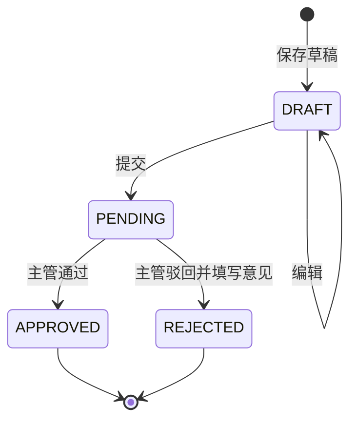

# 系统架构

系统采用 NocoBase 低代码平台与最小业务插件的组合。平台提供认证、集合、CRUD、ACL、表单、页面和图表；业务插件处理转正状态机、身份校验和数据一致性。

## 业务对象

| 对象 | 用途 |
|---|---|
| departments | 部门 |
| employees | 员工档案、直属主管、账号绑定、任职状态 |
| confirmation_requests | 草稿、待审批及审批结果 |
| approval_actions | 提交与决定的只读轨迹 |
| users / roles | 复用平台原生账号与角色 |
| prepDemoRegistry | root 专用的演示工具归属清单 |

员工与账号分开管理：员工可暂未开户，一个账号最多绑定一名员工。详见[数据模型](../../config/model.md)。

## 审批流程

驳回后的重新申请创建新记录，保留旧结果。通过审批时同时更新员工状态为 REGULAR。

## 权限与一致性

- 员工查看本人档案及申请；主管查看本人和直属下属，处理指定给本人的待办；HR 维护全量主数据及统计。
- 页面菜单控制可见性；实际读写由平台服务端动作权限、字段白名单和数据范围控制。
- 四个受控动作在服务端确定申请人及审批人，拒绝客户端伪造状态和身份；HR 通用编辑不允许直接变更任职状态。
- 决定动作使用事务和申请行锁，保证申请结论、轨迹和员工状态同时提交或回滚。
- 账号唯一绑定在平台模型声明，由数据库约束落实；关系守卫禁止自管理，并在 PENDING 期间冻结员工账号和主管变更。
- 统计由 charts 在服务端合并角色范围后聚合，详见[统计口径](REPORT-DEFINITIONS.md)。

## 部署与代码

Compose 管理 app 与 postgres 两个服务。应用仅绑定本机，数据库不向宿主机暴露端口，数据通过 Docker 卷持久化。插件目录只读挂载至 storage/plugins。

`packages/plugins/@nocobase/plugin-hris-confirmation/dist/server/` 是手写 JavaScript 源码，直接部署，不应当作构建缓存删除。页面 schema、角色和模型通过 scripts 中的官方 API 调用脚本建立。

备份与校验清单共享 PostgreSQL 导出快照；恢复在新建隔离库中校验摘要、表结构与业务快照，不覆盖运行库。

## 当前边界

单实例、单级审批，不含薪酬、考勤、多租户或高可用。当前验证对象为 NocoBase 2.2.37 与 PostgreSQL 16.3。参见[已知边界](../quality/LIMITATIONS.md)。
